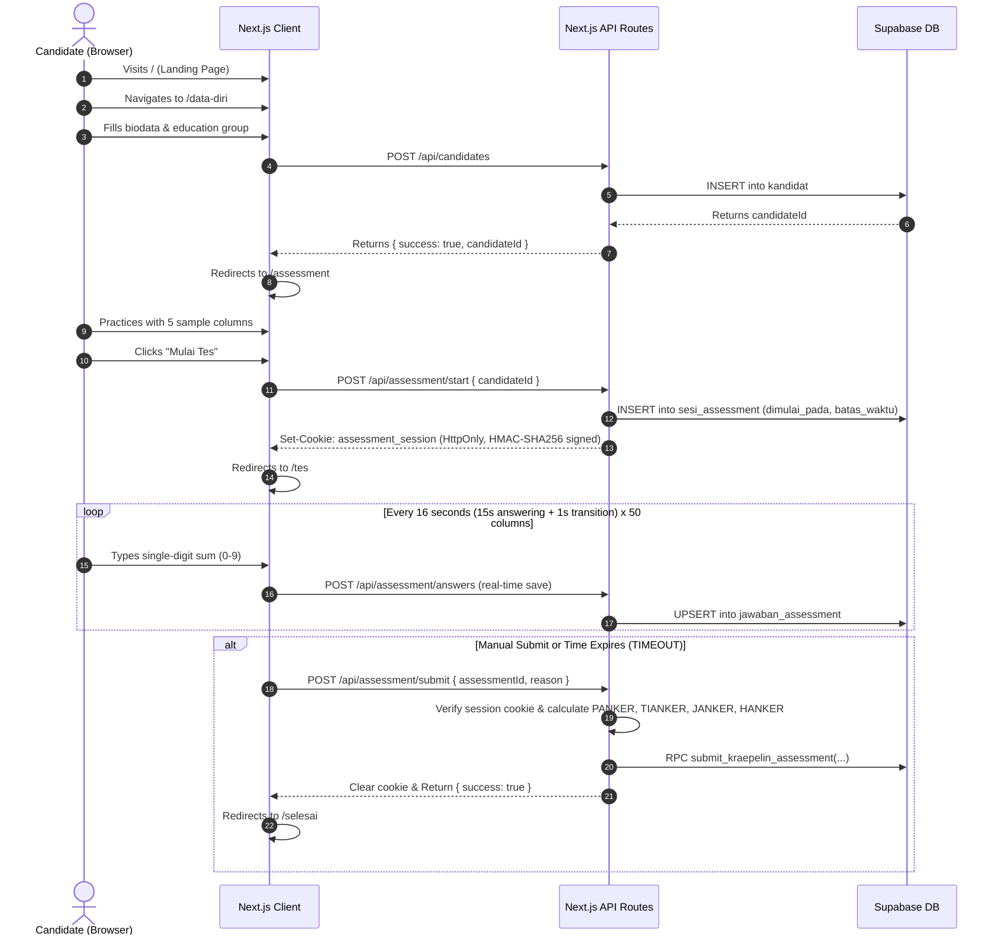

# System Architecture: Kraepelin Online

`kraepelin-online` is a web-based psychometric assessment platform (specifically for the **Kraepelin Test** / *Tes Koran*) used for online candidate recruitment and evaluation. It features strict column-by-column timer enforcement, real-time incremental saving, tamper-proof session verification via cryptographic cookies, and automated psychometric scoring normalized against education levels.

---

## 1. High-Level Tech Stack

| Layer | Technologies |
| :--- | :--- |
| **Framework** | Next.js 16.4.1 (App Router, Turbopack, React Compiler enabled) |
| **Language & Runtime** | TypeScript 5, Node.js (v20+) |
| **Frontend UI** | React 19.3.0, Tailwind CSS v4 (`@tailwindcss/turbopack`), Lucide React |
| **Database & Auth** | Supabase (`@supabase/supabase-js`), PostgreSQL with PL/pgSQL RPCs |
| **Session Security** | HMAC-SHA256 signed HttpOnly session cookie |

---

## 2. Directory Structure

```text
kraepelin-online/
├── docs/                             # Core project documentation for humans & AI
│   ├── ARCHITECTURE.md               # System design & architecture (this file)
│   ├── DOMAIN_KRAEPELIN.md           # Kraepelin rules, math, scoring & norms
│   ├── DATABASE_SCHEMA.md            # Supabase schema, tables & RPCs
│   └── TESTING_AND_VERIFICATION.md   # Testing endpoints, build & dev guidelines
├── src/
│   ├── app/
│   │   ├── layout.tsx                # Root layout (Geist font, metadata)
│   │   ├── page.tsx                  # Landing page (hero, instructions overview)
│   │   ├── data-diri/
│   │   │   └── page.tsx              # Candidate registration / biodata form
│   │   ├── assessment/
│   │   │   └── page.tsx              # Interactive practice & pre-test simulation
│   │   ├── tes/
│   │   │   ├── page.tsx              # Official Kraepelin test runner (50 columns)
│   │   │   └── data-soal.ts          # Static 50-column matrix (28 numbers / column)
│   │   ├── selesai/
│   │   │   └── page.tsx              # Completion confirmation page
│   │   └── api/
│   │       ├── candidates/           # POST: Register candidate biodata
│   │       ├── assessment/
│   │       │   ├── start/            # POST: Initialize test session & issue signed cookie
│   │       │   ├── session/          # GET: Verify active session status
│   │       │   ├── answers/          # GET: Load answers / POST: Auto-save answer
│   │       │   └── submit/           # POST: Finalize test (MANUAL or TIMEOUT)
│   │       └── test-*/               # Development-only test & diagnostic endpoints
│   └── lib/
│       └── server/                   # Server-only business logic & DB adapters
│           ├── assessment-session.ts # Session cookie signing, verification & timing configs
│           ├── kraepelin.ts          # Pure indicator formulas (PANKER, TIANKER, JANKER, HANKER)
│           ├── kraepelin-scoring.ts  # Column answer scoring & skip calculations
│           ├── kraepelin-norma.ts    # Education group norm ranges & category mapping
│           ├── kraepelin-hasil.ts    # Pipeline integrating scoring, indicators, and norms
│           ├── kunci-jawaban.ts      # Precomputed correct answers for all 50 columns
│           ├── supabase.ts           # Public/anon client (server-side)
│           └── supabase-admin.ts     # Privileged service-role client (server-side)
├── .cursor/rules/                    # Modular Cursor rules (.mdc)
├── .github/copilot-instructions.md   # GitHub Copilot system instructions
├── AGENTS.md                         # Universal AI agent rules (preserves Next.js block)
├── CLAUDE.md                         # Anthropic / Claude Code guide
├── .cursorrules                      # Legacy Cursor fallback
├── llms.txt                          # LLM discovery index
├── next.config.ts                    # Next.js config (Turbopack, cacheComponents, reactCompiler)
└── package.json
```

---

## 3. End-to-End User Flow



---

## 4. Key Architectural Principles

1. **Server-Only Security Boundary**:
   - All modules in `src/lib/server/*` use `import "server-only";`.
   - Sensitive calculations, correct answers (`kunci-jawaban.ts`), scoring formulas, and admin database operations MUST NEVER leak to client bundles.
2. **Deterministic Timing**:
   - Deadlines are anchored on the server (`batas_waktu` in `sesi_assessment`). Client-side clocks are only for UI display; submissions after the server-calculated deadline (plus grace window) are rejected or flagged as `TIMEOUT`.
3. **Resilient Data Capture**:
   - Every answer entered by the candidate is sent to `/api/assessment/answers` immediately. If a browser crashes, the candidate can reconnect without losing previous columns.
4. **Clean Decoupling of Domain Math**:
   - [`src/lib/server/kraepelin.ts`](file:///d:/kraepelin-online/src/lib/server/kraepelin.ts) is a pure mathematical helper with 0 external dependencies (no DB, no Next.js APIs). This guarantees it can be independently unit-tested without mocks.

